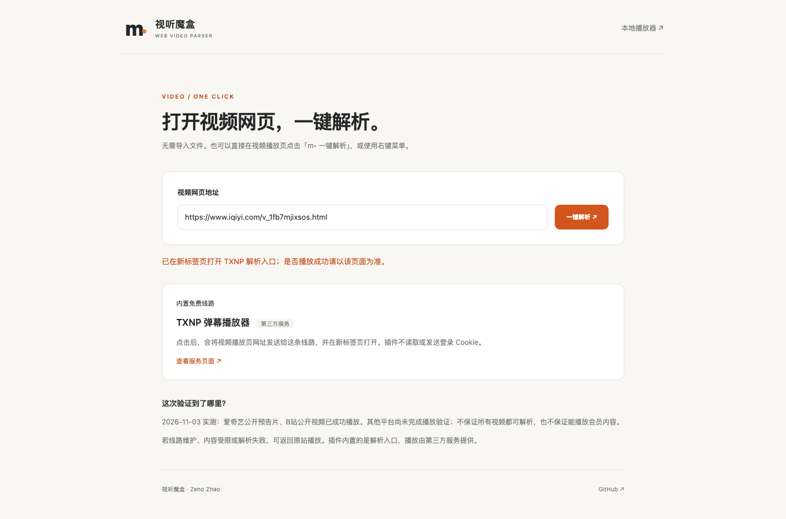
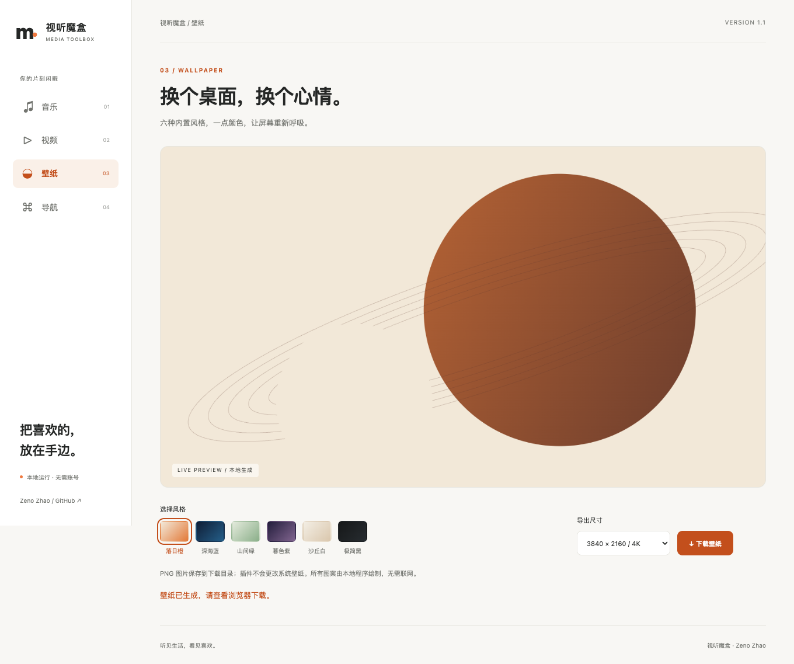
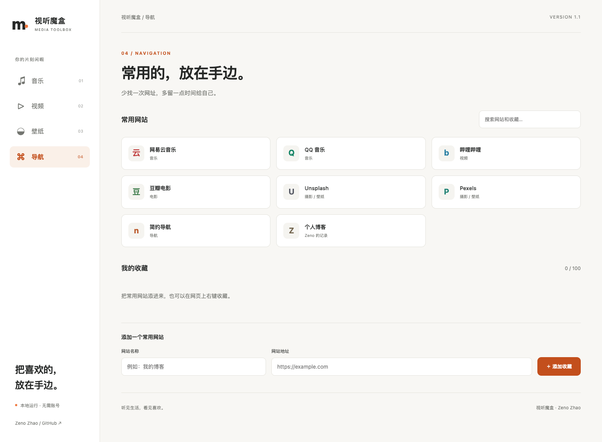

# 视听魔盒 · 网页视频一键解析

**在视频播放网页，点一下就打开解析。** 适用于 Chrome / Edge 的 Manifest V3 扩展，内置免费第三方解析入口，支持悬浮按钮、右键菜单和工具栏操作；另附本地媒体、壁纸与导航工具。

> **1.1.0 已恢复网页一键解析。** 无需本地文件、代理或 API Key；点击后会把当前视频网址交给内置的 TXNP 第三方播放器，在新标签页打开。已经用爱奇艺公开预告片和 B站公开视频验证播放；不保证所有平台、所有视频或会员内容可用。线路情况见 [服务核验记录](docs/parser-services.md)。

[下载安装包](https://github.com/zcjunblog/stmh-chrome-Browser-extensions/releases/latest) · [安装方法](#安装) · [四个工具](#四个工具) · [开发与验证](#开发与验证) · [隐私说明](PRIVACY.md) · [更新记录](CHANGELOG.md)



## 网页一键解析

1. 安装后打开视频网站的**具体视频播放页**。
2. 点击网页右侧的 **m• 一键解析**，或右键选择 **视听魔盒：一键解析当前视频**；也可以点工具栏图标中的「一键解析」。
3. 插件会在新标签页打开内置线路。无需下载视频，也不用导入本地文件；若浏览器阻止自动播放，请在解析页点击播放。

在其他页面上，可从弹窗点击「粘贴视频网址 / 查看内置线路」，手动输入播放页地址。按钮支持识别爱奇艺、腾讯视频、优酷、芒果TV和 B站的常见播放页；**识别网址不等于已验证播放**：本次仅实测爱奇艺预告片与 B站公开视频。其他平台仍需实际测试，具体由第三方线路支持情况决定。

内置线路：[TXNP 弹幕播放器](https://art.txnp.cn/)。其公开页面提供带 `?url=` 参数的调用入口。扩展只打开该页面，不复制该站的播放器、广告或远程脚本到扩展中。点击前不会请求解析服务，不读取或发送 Cookie；无关跟踪参数和网址片段会被去掉，保留视频地址和必要的分P / 剧集参数。

新安装后，已打开的视频页需要刷新一次，才能出现悬浮按钮。可以关闭本页按钮；切换到新剧集地址后会重新显示。线路故障时，请返回原站播放。

## 其他工具与补充功能

| 工具 | 可以直接使用的功能 | 使用边界 |
| --- | --- | --- |
| 🎵 音乐 | 多文件歌单、拖放打开、上一首 / 下一首、单曲循环、倍速、音量、播放进度记忆 | 文件只在本机读取；重开工具后需要重新选择文件 |
| 🎬 视频 | 网页一键解析；另有本地 / 直链播放器、倍速、全屏和截图 | 网页解析依赖内置第三方线路；本地播放受编码支持限制，在线截图受跨域策略限制 |
| 🎨 壁纸 | 六种本地生成风格、1080p / 2K / 4K PNG 导出 | 保存图片后由用户设置桌面壁纸；不依赖图片 API |
| 🔖 导航 | 常用网站分类入口、自定义收藏、筛选搜索、右键收藏网页或链接 | 收藏仅保存在当前浏览器；在线站点内容和可用性由站点提供方决定 |

关闭工具栏弹窗不会中断音乐；在同一工具页切换壁纸、导航时，音乐也可以继续播放。关闭或刷新**工具页标签**会停止播放。

### 音乐与视频

1. 打开扩展，选择「听点音乐」，或从解析页右上角打开「本地播放器」。
2. 选择文件，或把文件拖进文件选择区，点击播放。可一次选择多个文件。
3. 下次打开，重新选择同一文件即可恢复进度。已播放完的文件从头开始。

进度按文件名、大小、修改时间区分；最多保存最近 200 个进度记录。选择新文件会替换当前分类的播放列表。音频、视频格式和编码支持取决于浏览器，例如 MP3、WAV、OGG、MP4、WebM；文件后缀本身不保证可解码。

视频直链应直接指向媒体文件，例如 `https://example.com/video.mp4`。可在「视频」中粘贴，或在网页的音视频 / 链接上右键，选择「用视听魔盒打开媒体直链」。不下载网页内容，不提取受保护的视频流。

### 壁纸

选择落日橙、深海蓝、山间绿、暮色紫、沙丘白或极简黑，预览后选择尺寸并下载。绘制和 PNG 导出都在本机完成，离线可用。



### 导航与收藏

内置音乐、视频和摄影网站的公开入口。可添加自己的名称和 HTTP(S) 网址；重复网址更新原收藏，最多保存 100 条。也可以从工具栏弹窗收藏当前网页，或在网页上右键收藏。浏览器内部页、脚本地址和带账号密码的网址不能收藏。



## 安装

适用于 **Chrome 120+ / Edge 120+** 等支持 Manifest V3 的桌面 Chromium 浏览器。自动化验收在项目锁定的 Playwright Chromium 上运行，其他浏览器需自行验证。

1. 下载本仓库源码 ZIP，或维护者提供的 `stmh-toolbox-1.1.0.zip` 安装包，并解压到一个固定目录。
2. 打开 Chrome 的 `chrome://extensions`，或 Edge 的 `edge://extensions`。
3. 开启「开发者模式」，点击「加载已解压的扩展程序」。
4. 选择包含 `manifest.json` 的 **`stmh-chrome` 文件夹**，然后将视听魔盒固定到工具栏。

运行插件无需 Node.js、npm、代理服务或额外账号。本项目没有声称已上架 Chrome 网上应用店；请勿把源码目录直接当作商店签名 CRX 安装。

从旧版升级时，用新版文件替换原扩展目录后点「重新加载」。如果安装了不同来源的旧 CRX，可先停用旧扩展，再加载新版，避免混淆。

## 隐私与权限

- **本地媒体不上传**：通过浏览器 File API 读取用户主动选择的文件；不会自动扫描磁盘。
- **无统计、无账号、无远程代码**：仅在列出的视频站点运行本地悬浮按钮脚本，用于识别当前网址和打开解析，不读取视频内容或 Cookie；不请求全站访问权限。
- `storage`：保存收藏、播放设置和进度；`contextMenus`：右键入口；`activeTab`：用户主动操作弹窗时解析或收藏当前网页。
- 只有主动点击解析、打开外部网站、加载媒体直链等操作才会访问对应网站。在线站点可能要求登录、付费或拥有自己的隐私政策。
- 清理扩展数据或卸载扩展会丢失本机收藏与进度。详见 [PRIVACY.md](PRIVACY.md)。

## 开发与验证

运行源码无需构建；测试需要 Node.js 22+ 和 Python 3.9+：

```sh
git clone https://github.com/zcjunblog/stmh-chrome-Browser-extensions.git
cd stmh-chrome-Browser-extensions
npm ci
npx playwright install chromium
npm test
npm run test:browser
npm run package
```

- `npm test`：URL 安全校验、收藏去重与上限、播放进度边界、打包资源完整性与可复现性。
- `npm run test:browser`：**解压实际生成的 ZIP 并加载到 Chromium**，验证真实音视频解码播放、进度恢复、并发收藏、媒体直链、全屏、画面截图和 4K PNG 尺寸。
- `npm run package`：输出 `dist/stmh-toolbox-1.1.0.zip` 和 `dist/SHA256SUMS`；扩展运行不依赖测试包。
- 壁纸和测试音视频均由程序生成，没有打包第三方影视、音乐或壁纸素材。截图中的音视频为合成验收样本。

```text
stmh-chrome/        可直接加载的扩展
  js/background.js MV3 解析入口、菜单、收藏和进度存储
  js/parser.mjs    视频网页校验与内置解析线路
  js/content-parser.js 视频站点悬浮按钮
  js/media.mjs     本地 / 直链播放器
  js/wallpaper.mjs 壁纸绘制与 PNG 导出
  js/navigation.mjs网站入口与收藏界面
tests/             数据、安装包及浏览器验收
scripts/           可复现安装包生成
```

## 从 2019 到现在

旧版以第三方网站嵌入和视频解析入口为主，随后部分域名变更用途、路径失效，加上 Manifest V2 退役，原实现不再适合直接使用。1.1.0 恢复网页一键解析流程，内置经过公开样本验证的第三方入口，并将本地播放器保留为补充功能。旧代码可在 Git 历史中查阅。

由 [Zeno Zhao · zcjunblog](https://github.com/zcjunblog) 维护 · [个人博客](https://x4v.cn/) · [反馈问题](https://github.com/zcjunblog/stmh-chrome-Browser-extensions/issues)
